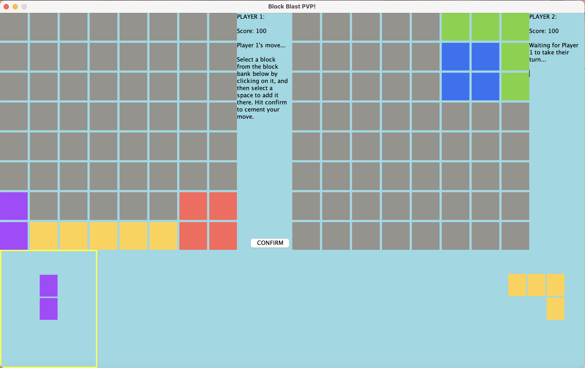

# Initial Game State

This directory preserves the initial version of BlockBlast PvP that my partner and I submitted as our final project in high school, for transparency and reference. 

It contains both the submitted project executable (`BlockBlastBattle.jar`) and the original source code (in `blockblast/`).

## Screenshot of original GUI

